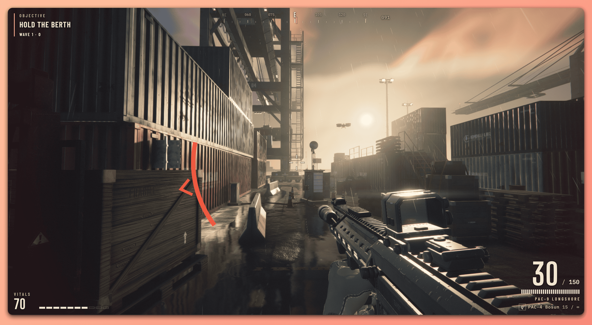
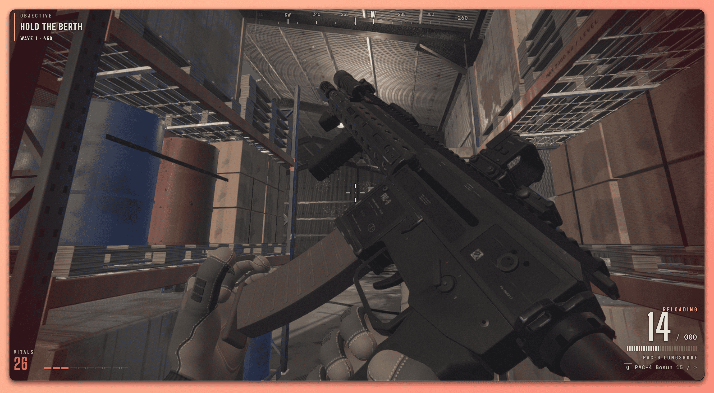
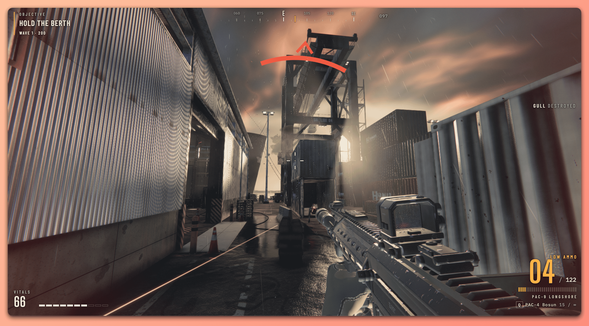

# Saltline

从 [原始 Claude Artifact](https://claude.ai/artifact/BGY1SztrAYcJQHSsnHHGmp) 恢复的完整可运行版本，保留原游戏画面、关卡、敌人、武器、音效、操作和菜单。

## 在线试玩

**[打开 Saltline](https://realskyrin.github.io/fps3ademo-saltline/)**，点击 **DEPLOY** 开始游戏。

## 游戏截图







## 本地开发

需要 Node.js 20.19+ 或 22.12+。推荐使用当前 LTS 和 Chrome/Edge 等支持 WebGL 2 的浏览器。

```sh
git clone https://github.com/realskyrin/fps3ademo-saltline.git
cd fps3ademo-saltline
npm ci
npm run dev
```

打开 <http://127.0.0.1:5173/>，点击 **DEPLOY** 开始。修改脚本或样式后浏览器会重新加载，当前局会重置。

依赖已经安装时，直接执行 `npm run dev`。游戏、Three.js 和全部字体均在本地，运行期间不需要 Claude、Google Fonts 或其他在线服务，也不需要 API Key。

## 构建和预览

```sh
npm run check
npm run build
npm run preview
```

构建结果在 `dist/`，预览地址是 <http://127.0.0.1:4173/>。可将 `dist/` 放到任意静态 HTTP 服务；应通过 HTTP 打开，以便脚本模块和浏览器输入正常工作。

## GitHub Pages 部署

仓库已启用 GitHub Pages，发布来源为 **GitHub Actions**。[部署工作流](https://github.com/realskyrin/fps3ademo-saltline/actions/workflows/pages.yml) 在推送到 `main` 时自动运行，也可通过 **Run workflow** 手动触发。工作流检查 Pages 配置，执行 `npm ci`、`npm run check` 和 `npm run build`，然后发布 `dist/`。

在其他仓库使用这套工作流时，需要先到 **Settings → Pages → Build and deployment → Source** 选择 **GitHub Actions**，否则部署接口会返回 404。

## 继续修改

| 文件 | 内容 |
| --- | --- |
| `index.html` | 页面入口、画布、启动界面 |
| `src/game.js` | 6 行启动入口，安装道具注册表和错误捕获后启动游戏 |
| `src/app/` | 系统装配、主循环、启动界面、诊断和基准模式 |
| `src/vendor/three-r180.js` | 独立保存的原版 Three.js r180，提供标准命名的导出 |
| `src/core/` | 世界/画质配置、事件、随机数、数学、通用几何和降级实现 |
| `src/render/` | 渲染器、天空、阴影、后处理、材质、纹理和着色器 |
| `src/world/` | 碰撞、道具注册与建模、关卡、远景、地面和水面 |
| `src/input/`、`src/player/`、`src/combat/` | 输入、玩家和战斗判定 |
| `src/weapons/`、`src/enemies/` | 武器/敌人的模型、动画和行为 |
| `src/audio/`、`src/effects/` | 声音合成、音库、混音、粒子和特效 |
| `src/ui/`、`src/game/` | HUD、菜单、设置和任务流程 |
| `src/ui.css` | 原版 HUD、菜单、移动端布局和动效 |
| `src/fonts.css`、`public/fonts/` | 原版三组字体的本地副本 |
| `vite.config.js` | 开发服务器、构建和 source map 配置 |
| `archive/original.html` | 与原站发布清单逐字节校验一致的原始单文件 |
| `archive/manifest.json` | 来源、发布版本、原始大小与 SHA-256 |
| `docs/DEVELOPMENT.md` | 游戏代码定位和诊断入口 |
| `docs/VALIDATION.md` | 本次恢复的验收结果 |
| `docs/REFACTOR_VALIDATION.md` | 模块拆分的代码、场景、截图与操作回归记录 |
| `licenses/` | Three.js 与字体的许可文本 |

**源码边界：**公开链接只提供一个已打包的 `index.html`，没有发布前的多文件源码、原始变量名或 source map。本地在恢复完整产物后，将它重新组织为 66 个 ES 模块，并为引擎导入、主要工厂函数和上下文参数补充了可读名称。复杂算法内部仍有原版压缩过的局部变量名。模块边界是本地重建的，构建生成的 source map 对应当前本地文件。

## 操作

| 动作 | 按键 |
| --- | --- |
| 移动 / 视角 | WASD / 鼠标 |
| 开火 / 瞄准 | 鼠标左键 / 右键 |
| 换弹 / 近战 | R / F |
| 跳跃 / 冲刺 | Space / Shift |
| 蹲下 | C 或 Ctrl |
| 切断中继 | 在中继附近按住 E |
| 暂停 | Esc 或 P |

浏览器无法锁定鼠标时，原版也支持按住鼠标拖动视角，或方向键 / IJKL 转向、Enter 开火。触屏和手柄支持沿用原版，具体布局在 **CONTROLS** 中查看。

设置保存在当前浏览器的 `localStorage`（`saltline.settings.v1`）。本地地址与原站的浏览器存储相互独立。

## 原件校验

恢复日期：2026-11-10；公开版本：`1794242702-61c7`。

```sh
npm run verify:archive
```

原件大小为 1,423,413 字节，SHA-256：

```text
f7081ef7b2fde5880e3c58184c720b2aa3b9115efe58ff71b48f6820d4f16f90
```

原件保留原始 Google Fonts 链接；本地开发入口使用已下载的字体。Claude 的页面外壳与注入运行时未加入本地游戏。
